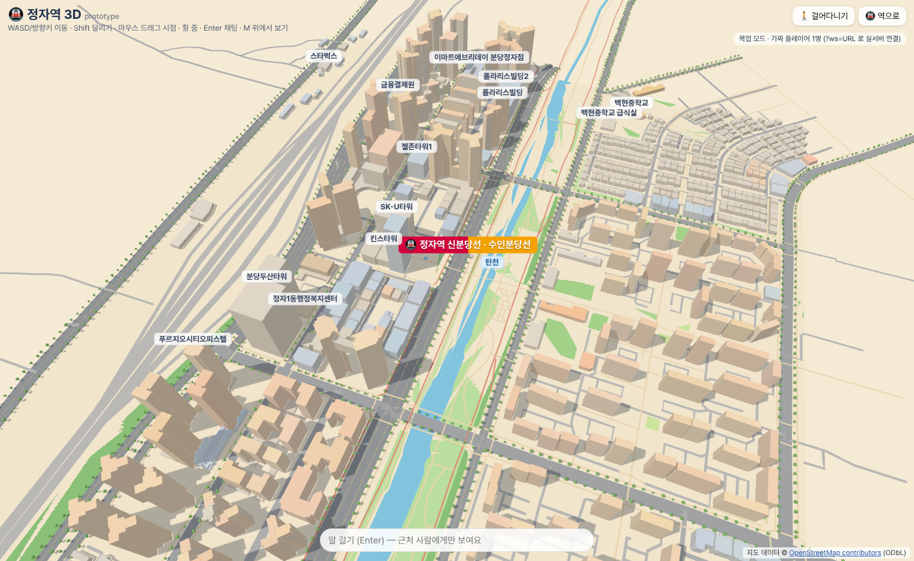
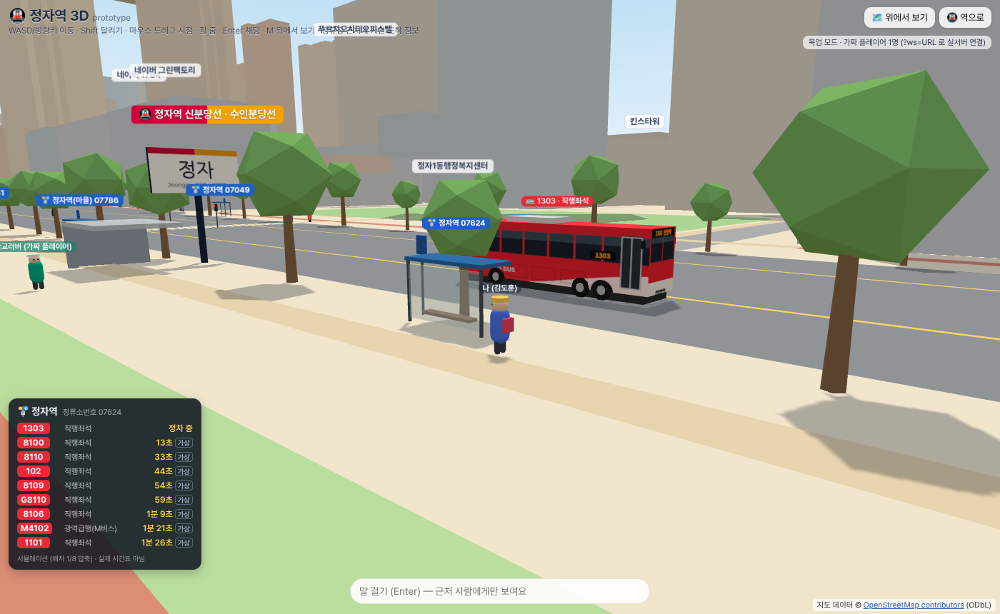
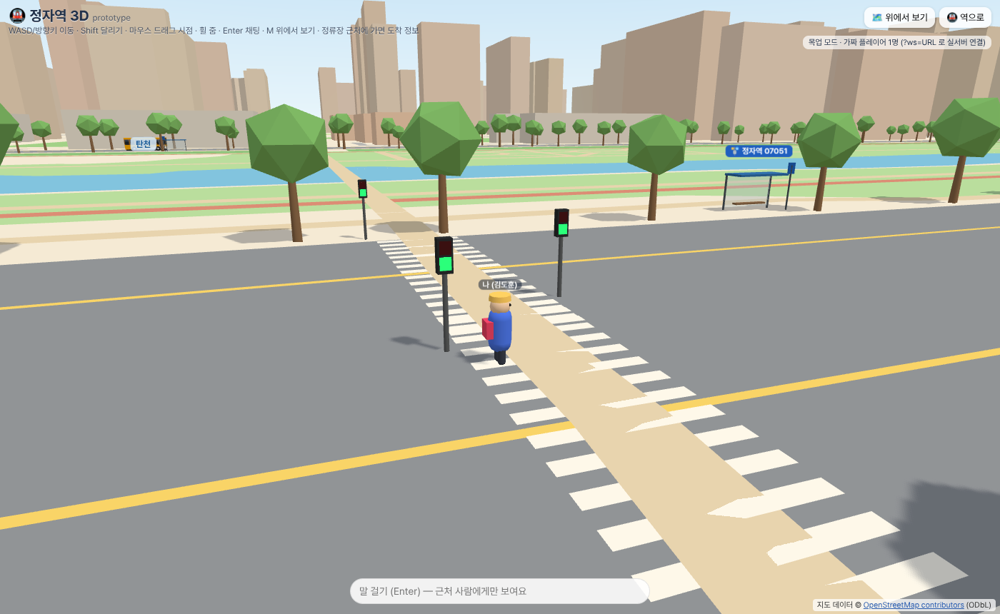

# 🌍 Bumpinto World — Source-Available 3D Real-World Metaverse

> **🌐 Live World**: **[https://bumpinto.world](https://bumpinto.world)**  
> **🏗️ Created by**: **[CrazyLabs (crazylabs.co.kr)](https://crazylabs.co.kr)** · **📖 [Contributing Guide (English / 한국어)](./CONTRIBUTING.md)**

---

## 🇺🇸 Overview (English)

**Bumpinto World** is a lightweight, zero-asset-download 3D open world running directly in the browser with **Three.js**, **OpenStreetMap (OSM)** real-world geometry, **real-time public transit APIs**, and **Cloudflare Durable Objects** (WebSockets multiplayer, virtual phone/SMS with PIN recovery, and in-game community board).

Our first live district is **Jeongja Station (Bundang, South Korea)** (~900m radius, including Naver 1784, Tancheon stream trails, real bus routes, and Kakao T bikes). Because one person cannot build the entire world alone, we are opening the project so contributors worldwide can help build new neighborhoods, procedural 3D landmarks, and street NPCs.

### 🤝 Why Contribute? (Mutual Promotion & In-Game Credits)
Every merged Pull Request earns permanent recognition inside the live **[bumpinto.world](https://bumpinto.world)** experience:
- **👑 In-Game Hall of Fame (`src/contributors.js`)**: Feature your name, badge, and link (GitHub / personal site / company) inside the in-game **`🌍 함께 만들기 (Contribute)`** modal.
- **🏢 3D Building & Region Pioneer Credits**: Model a custom landmark or convert a new city/station from OSM to have your handle engraved on the 3D building plaque or globe region list.
- **🗣️ Custom Citizen NPC**: Add your own avatar and dialogue lines to `src/entities/npcs.js` to walk the streets 24/7.
- 👉 **Read the full [English & Korean Contributing Guide (CONTRIBUTING.md)](./CONTRIBUTING.md)** to get started in 5 minutes!

### ⚡ Quick Start
```bash
npm install
npm run dev            # http://localhost:5173 (Node.js 22+ recommended)
```

---

## 🇰🇷 프로젝트 소개 (한국어)

**Bumpinto World**는 실제 도시 데이터(OpenStreetMap)와 실시간 대중교통 API를 결합해 브라우저에서 바로 걸어 다니고, 마주치는 사람들과 대화·문자·커뮤니티를 나누는 **소스 공개 3D 메타버스 월드**입니다.

첫 번째 오픈 지역인 **성남시 분당구 정자역(정자동)** 반경 약 900m를 시작으로, **수내역 · 서현역 · 이매역 · 야탑역 · 판교역 · 강남역 · 성수동 · 홍대입구** 등 다음 동네와 랜드마크 건물을 **소스 공개에 참여하는 기여자들과 상부상조하며 함께 확장**하고 있습니다.

### 🤝 함께 만들기 & 기여자 리워드 (Win-Win)
혼자서 모든 동네를 다 만들 수 없기에 소스를 공개합니다. PR을 통해 **새 지역(동네) 변환, 3D 랜드마크 건물, 시민 NPC 대사, 주변 맛집**을 추가해 주시면:
1. 공식 라이브 월드([bumpinto.world](https://bumpinto.world))의 **`🌍 함께 만들기 & 명예의 전당`**에 **제작자 이름·배지·본인 링크(GitHub/블로그/회사)**가 영구 등재됩니다.
2. 제작하신 3D 건물 및 지역에 **개척자(Pioneer) / 건축가 크레딧**이 각인됩니다.
3. 자세한 참여 방법은 **[CONTRIBUTING.md](./CONTRIBUTING.md)** 를 참고해 주세요!



| 정자역 정류장(07624)에 정차한 1303번 직행좌석 | 보행 초록불 횡단보도(성남대로) |
|---|---|
|  |  |

## 실행 방법

```bash
npm install
npm run dev            # http://localhost:5173
# 또는 빌드 후 미리보기
npm run build && npm run preview   # http://localhost:4173
```

- `dist/` 폴더는 순수 정적 파일입니다. Cloudflare Pages에 그대로 올리면 됩니다 (`vite.config.js`의 `base: './'` → 하위 경로에서도 동작).
- 런타임 API 호출 없음(기본): 지도 `public/jeongja.json`(약 200KB) + 버스/횡단보도 `public/transit.json`(약 23KB)만 로드합니다.

### 조작
| 입력 | 동작 |
|---|---|
| WASD / 방향키 | 이동 (카메라 기준) |
| Shift | 달리기 |
| 마우스 드래그 / 휠 | 시점 회전 / 줌 |
| Enter | 채팅 입력 (내 머리 위 말풍선 + 프레즌스로 전송) |
| M | 위에서 보기 ↔ 걷기 |
| H | 역으로 돌아가기 |
| 모바일 | 왼쪽 아래 가상 조이스틱 + 화면 드래그로 시점 |

URL 파라미터: `?view=overview` (조감도로 시작), `?name=닉네임`, `?npcs=0~32` (기본 32, `src/entities/npcs.js`의 인원까지), `?noshadow=1` (저사양), `?ws=wss://…` (실서버 프레즌스), `?bus=realtime&proxy=https://…` (실시간 버스 도착정보, 아래 참고).

정류장(🚏) 근처 22m 안으로 가면 왼쪽 아래에 **정류장 패널**(노선 번호·유형·다음 도착)이 뜹니다.

## 데이터 파이프라인

```
data/query.overpassql  ──(npm run fetch-osm: Overpass, 재시도/백오프)──▶ data/osm_raw.json
api.openstreetmap.org /map + /relation/9035438/full ──▶ data/osm_api_*.xml
      └─ python3 scripts/osmxml_to_overpass.py ──▶ data/osm_raw_osmapi.json
npm run convert (scripts/convert.mjs) ──▶ public/jeongja.json  (정자역 기준 로컬 미터 좌표)
data/query_transit.overpassql ──(npm run fetch-transit)──▶ data/osm_transit_raw.json   (버스 노선 relation + 정류장, 원본 보관)
gbis.go.kr 인허가 노선 목록(성남/용인/광주/평택) ──▶ data/gbis_route_types.json        (노선 유형 판정 근거)
npm run convert-transit (scripts/convert-transit.mjs) ──▶ public/transit.json          (bbox 안 경로·정류장·횡단보도·신호)
```
(`npm run convert`는 두 변환을 모두 실행합니다.)

- 중심 좌표: Nominatim 기준 정자역 노드 2개 `37.36623,127.10811`(신분당선), `37.36665,127.10844`(수인분당선) → 중심 `37.36650, 127.10835`.
- bbox: `37.3580,127.1015 ~ 37.3720,127.1151` (남쪽으로 조금 넓혀 **네이버 그린팩토리/1784**까지 포함).
- 건물 높이: `height` 태그 → 없으면 `building:levels × 3.2m` → 둘 다 없으면 **기본 3층(9.6m)**. `min_height`도 반영.
- 도로: `highway`를 종류별 폭(차선 수 있으면 `lanes × 3.2m`)의 평평한 리본으로. 지하(tunnel/음수 layer)는 제외.
- 물: 탄천 수면 멀티폴리곤(relation 9035438)을 전체로 받아 bbox로 클리핑, 공원/녹지: `leisure`/`landuse`/`natural`.
- 기본은 **OSM 공식 API(실시간)** 데이터를 사용합니다. 작업 당시 공개 Overpass 서버들이 과부하였고, 응답한 미러의 데이터가 2026-07-15 스냅샷이라 건물이 68개 적었습니다. Overpass 원본으로 바꾸려면 `SOURCE=overpass npm run convert`.

## 코드 구조

```
src/
  main.js              부트스트랩, 렌더 루프, 카메라, 플레이어 이동/충돌
  world.js             jeongja.json → three.js 메시(건물 압출, 도로 리본, 물, 공원, 가로수, 역 표지판), 충돌 격자
  overlay.js           HTML 오버레이(이름표/말풍선/지명 라벨) 3D→화면 투영
  input.js             키보드 + 마우스 + 터치 조이스틱
  entities/avatar.js   로우폴리 아바타/고양이 + 걷기 애니메이션
  entities/npcs.js     NPC 정의(대사 포함), 도로를 따라 배회, 근접 시 대사, 빨간불이면 횡단보도 앞 대기
  transit/transit.js   횡단보도(지브라)·보행신호등·정류장 쉘터/라벨·버스 메시·정류장 패널, 신호 주기
  transit/busSource.js 버스 데이터 소스: SimulatedBusSource(기본) / RealtimeBusSource(프록시 경유 스텁)
  transit/busModel.js  로우폴리 버스(일반 저상/좌석·직행 코치/마을 소형) + 캔버스 텍스처(도색, LED, 창, 문)
  transit/livery.js    노선 유형 → 도색 매핑(출처 주석), routeTypeCd 코드표, 번호 패턴 분류
  net/protocol.js      멀티플레이 메시지 규격 (서버와 공유)
  net/presence.js      프레즌스 어댑터: MockPresence(기본) / WebSocketPresence(?ws=)
  net/remotePlayers.js 원격 플레이어 아바타 보간 + 근접 채팅 말풍선(30m)
  world/terrain.js     탄천 고저차(제방·둔치·하상) + 계단 + 다리 구조물, getGroundHeight(x,z)/canMove
  entities/taxis.js    시뮬레이션 택시(도로 그래프 무작위 주행, 신호 정지, 정자역 출입구 승차)
  entities/taxiModel.js 로우폴리 세단 + 택시 도색(카카오T 스타일/일반/개인/모범)
server/dev-relay.mjs   로컬 테스트용 초간단 WebSocket 릴레이 (배포용 아님)
server/bus-proxy/      경기도 버스 API용 Cloudflare Worker 프록시 예시(worker.js, wrangler.toml) + 로컬 목업(mock-proxy.mjs)
scripts/               convert / 스크린샷 / 멀티플레이 테스트
```

NPC 대사 수정은 `src/entities/npcs.js`의 `NPC_DEFS` 배열만 고치면 됩니다.

## 택시 · 탄천 지형 (추가 모듈, 자세한 합치기 안내는 MERGE_TAXI_TERRAIN.md)
- **택시(시뮬레이션)**: 기본 24대, `?taxis=N`(최대 80) / `?taxis=0` 끔. OSM 차도(일방통행 반영, `public/drive.json`)를 무작위로 주행하고, 버스와 같은 규칙으로 보행 초록불이면 정지선에서 멈춥니다. 가끔 정자역 출입구 근처 갓길에 6~10초 정차(승객 탑승). 도색은 **카카오T 스타일(일반화, 공식 로고 아님)** / 주황 일반택시 / 은색 개인택시 / 흰색 일반택시 / 검정 모범택시. 실제 택시 데이터 아님.
- **탄천 지형(근사)**: 도로·제방 위 0m 기준, 둔치(산책로·자전거길) **-6m**, 수면 -6.6m, 하상 -7.6m. 제방 경사는 OSM 둔치 길/도로 위치로 폭을 추정했습니다(실측 DEM 아님). `?terrain=0` 이면 예전처럼 평평.
- **계단 8곳**: OSM `highway=steps` 5곳 + 위치 근사 3곳. 단 높이 0.15~0.2m(30~40단), 난간 포함. 플레이어·NPC·원격 플레이어가 높이를 따라가고, 가파른 제방은 막혀서 계단(또는 경사로)으로만 내려갈 수 있습니다. 다리는 도로 높이 그대로(다리 밑 둔치도 걸어갈 수 있음).
- 데이터 재생성: `npm run convert-taxi-terrain` (원본 `data/osm_raw_osmapi.json`), 스크린샷: `npm run shots-taxi-terrain` (shot-7~9).

## 버스 · 정류장 · 횡단보도

### 무엇이 되나
- **노선/정류장은 OSM 실제 데이터**: `route=bus` relation 13개, 정류장 노드를 Overpass로 받아 `data/osm_transit_raw.json`에 원본 저장 → bbox 안 부분만 잘라 `public/transit.json`.
  - relation에 경로(way)가 있으면 그대로, 정류장만 있는 relation(1303, 7007-1, 109)은 도로 그래프(일방통행 반영)에서 정류장 사이를 최단경로로 이었습니다.
  - 정류장은 진행방향 **오른쪽**(22m 이내)에 있는 것만 그 노선의 정차 정류장으로 봅니다.
- **버스 시뮬레이션**(기본): 노선마다 배차간격으로 생성 → 경로를 따라 가감속 주행(오른쪽 차로) → 정류장에서 정차(약 9초) → bbox 끝에서 사라지고 반대편/처음에서 다시 등장. 경로가 bbox 안에서 끝나면(차고지·회차 등) 서서히 나타나고/사라집니다. 앞차와 간격 유지.
  - **시간 압축**: 배차간격을 1/8로 줄였습니다(안 그러면 몇 분에 한 대). 패널의 "가상" 도착시간은 **실제 시간표가 아닙니다**.
- **정류장**: 쉘터(지붕·벤치·표지판) + `🚏 이름 번호` 라벨. 가까이 가면 패널에 그 정류장을 지나는 노선(OSM `route_ref` + 실제 경로)과 다음 도착 예정.
- **횡단보도**: OSM `highway=crossing` 노드 47개에 지브라 줄무늬 + (신호 있으면) 정지선. 신호 횡단보도 25개에는 보행신호등(빨강/초록 사람).
  - 신호 주기 60초: 초록 20초 → 초록 깜빡임 6초 → 빨강. 같은 교차로(45m 안 묶음)에서 서로 직각인 두 방향은 30초 엇갈림(한쪽이 초록이면 다른 쪽은 빨강).
  - **버스**는 앞 45m 안 신호 횡단보도의 보행신호가 빨강이 아니면(초록/깜빡임) 정지선에서 멈춥니다.
  - **NPC**는 빨간불(깜빡임 포함)이면 횡단보도 앞에서 멈춰 기다립니다(가끔 "🚦 빨간불이네요" 말풍선). NPC 한 명은 역 앞 성남대로 횡단보도를 왕복합니다.
  - 실제 신호 시간은 공개 데이터가 없어 **임의 값**입니다. 차량 신호등은 없습니다.

### 정자역 근처 실제 노선 (OSM + gbis 기준)
| 정류장 (정류소번호) | 지나는 노선 (OSM route_ref) |
|---|---|
| 정자역 07624 | 102, 1101, 1303, 8100, 8106, 8109, G8110, M4102 (+8110: gbis 미확인) |
| 정자역(마을) 07786 | 109 (마을) |
| 정자역 07051 / 07049 | OSM에 route_ref 없음 |
| 두산위브제니스 07052 | 102, 117, 220, 250, 300, 380, 390, 520, 1101, 1303 |
| 아데나펠리스 07308 | 19, 102, 110, 116-1, 117, 220, 250, 300, 380, 390, 520, 820 |
| 정자2동행정복지센터 07090 | 33-1, 51, 101, 109-1, 220, 720-1, 720-1A, 3500, 7007-1, 9000, 9404, 9407 |

화면에서 실제로 **달리는** 노선(bbox 안 형상이 있는 것): 220(2개 구간), 7007-1, M4101, 9407(양방향), 1303, 109, 시외/고속 2개(OSM relation 이름 "고속", "서울→광주"). 나머지 노선은 형상이 bbox를 지나지 않거나 relation이 없어 **패널에만 "가상"**으로 나옵니다.

### 버스 도색(리버리) 매핑과 출처
노선 유형은 **추측하지 않고 경기버스정보(gbis.go.kr) 인허가 노선 목록**(성남·용인·광주·평택 `metroBus.action` / `townBus.action`)에서 확인했습니다 → `data/gbis_route_types.json`. 목록에 없는 110, 116-1, 9404, 8110만 번호 패턴으로 추정(패널/코드에 `src: pattern`으로 표시). 8110은 확인이 안 돼 시뮬레이션에서 뺐습니다.

| 유형 (routeTypeCd) | 색 | 차체 | 이 지역 노선 |
|---|---|---|---|
| 광역급행 M버스 (14) | 빨강 `#EE2737` + 파란 물결 라인 | 코치(1도어, 화물칸) | M4101, M4102 |
| 직행좌석 (11, 17) | 빨강 `#EE2737` | 코치 | 102, 1101, 1303, 3500, 7007-1, 8100, 8106, 8109, G8110, 9000, 9407 (+9404·8110 추정) |
| 좌석 (12) | 파랑 `#0085CA` | 일반 차체 | (이 지역 해당 없음) |
| 일반 (13) | 초록 `#009775` | 저상 일반(2도어) | 33-1, 51, 101, 220, 250, 300, 380, 390, 520, 720-1, 720-1A, 820 (+110·116-1 추정) |
| 마을 (30) | 노랑 `#F2A900` | 소형(8.6m) | 19, 109, 109-1, 117 |
| 프리미엄 | 금색 `#85714D` | 코치 | (코드만) |
| 공항 (51–53) | 검정 | 코치 | (코드만) |
| 시외/고속 (41–43) | 흰색 + 남색 띠 | 코치 | "고속", "서울→광주" |

공통 디테일: 앞 흰색 스윕 + "G BUS" 브랜드(마을은 "마을버스"), 앞/옆/뒤 **LED 노선번호**(앞은 번호+행선지), 창문 띠와 기둥, 오른쪽 문(일반 2개, 코치/마을 1개), 바퀴·휠아치·사이드미러. 전부 박스 지오메트리 + 캔버스 텍스처(노선별 캐시)라 로우폴리입니다.

출처:
- 경인일보 — 경기 버스 색상 체계(일반 초록, 직행좌석 빨강, 일반좌석 파랑, 마을 노랑, 공항 검정): https://www.kyeongin.com/article/373861
- 연합뉴스 2014 — 직행좌석형 빨강, 좌석형 파랑, 일반형 초록, "G" 경기 브랜드: https://www.yna.co.kr/view/AKR20140717143200060
- 나무위키 「경기도 시내버스/도색」 — 색상 코드(빨강 #EE2737, 파랑 #0085CA, 초록 #009775, 노랑 #F2A900, 금색 #85714D), 2020 신디자인, 2024 공공관리제(시군간 파랑/시내 초록)
- 데일리안 2022 — 대광위 광역버스(M버스) 빨강 + 물결 디자인: https://www.dailian.co.kr/news/view/1161360
- 노선 유형: 경기버스정보 https://www.gbis.go.kr (버스정보 → 인허가 노선 목록, centerId 성남 4113000000 / 용인 4146000000 / 광주 4161000000 / 평택 4122000000)

주의: 2024년 공공관리제 이후 **시군간 일반노선 일부는 파란색**으로 바뀌는 중인데, 노선별 실제 차량 도색 데이터는 없어서 일반은 모두 초록으로 그렸습니다. 운수사별 띠·광고·차종 차이도 반영하지 않았습니다.

## 실시간 버스 정보 붙이는 법 (경기도 공공데이터 API)

> 키는 신청하지 않았고, 이 저장소에서 실제 API를 호출한 적도 없습니다(작업 환경(해외 IP)에서는 `apis.data.go.kr` 연결이 TLS 단계에서 끊김). 아래는 공식 문서 기준 정리입니다.

### 필요한 서비스 (data.go.kr, 모두 무료 · **자동승인** · 개발계정 1,000건/일)
| 서비스 | data.go.kr | 엔드포인트 (`https://apis.data.go.kr/6410000/…`) | 주요 파라미터 | 용도 |
|---|---|---|---|---|
| 경기도_버스도착정보 조회 | [15080346](https://www.data.go.kr/data/15080346/openapi.do) | `busarrivalservice/v2/getBusArrivalListv2` · `getBusArrivalItemv2` | `stationId` (+`routeId`, `staOrder`) | 정류장 도착예정 (`predictTimeSec1/2`, `locationNo1/2`, `remainSeatCnt1/2`, `routeName`, `routeTypeCd`, 저상 여부 등) |
| 경기도_버스위치정보 조회 | [15080648](https://www.data.go.kr/data/15080648/openapi.do) | `buslocationservice/v2/getBusLocationListv2` | `routeId` | 노선의 운행 중 차량 (정류소 순번 기준, **좌표 없음**) |
| 경기도_버스노선 조회 | [15080662](https://www.data.go.kr/data/15080662/openapi.do) | `busrouteservice/v2/getBusRouteListv2` · `getBusRouteInfoItemv2` · `getBusRouteStationListv2` · `getBusRouteLineListv2` | `keyword` / `routeId` | 노선 ID 찾기, 경유 정류소(x,y), 노선 형상 |
| 경기도_정류소 조회 | [15080666](https://www.data.go.kr/data/15080666/openapi.do) | `busstationservice/v2/getBusStationListv2` · `getBusStationViaRouteListv2` · `getBusStationAroundListv2` | `keyword` / `stationId` / `x,y` | 정류소번호(mobileNo, 예: 07624) → `stationId` 변환, 경유 노선 |

- 공통: `serviceKey`(필수), `format=json`(기본 XML). 응답은 `response.msgHeader.resultCode`(0 정상, 4 결과 없음, 1/2 오류) + `response.msgBody.*`.
- 게이트웨이 오류(XML로 옴): 20 `SERVICE_KEY_IS_NULL`/권한 없음, 22 일일 한도 초과, 23 초당 한도 초과, 29 IP 차단(BLACKLIST_IP_ACCESS_ERROR).
- 트래픽: 개발계정 1,000건/일 → 활용사례 등록하면 운영계정으로 상향 신청 가능. 그래서 프록시에 캐시를 둡니다(도착 20초, 정류소 하루).
- `routeTypeCd` 코드: 11 직행좌석, 12 좌석, 13 일반, 14 광역급행, 15 따복, 16 순환, 17 준공영 직행좌석, 21–23 농어촌, 30 마을, 41–43 시외, 51–53 공항 → `src/transit/livery.js`의 `ROUTE_TYPE_CD`로 도색 결정.

### 사용자가 직접 해야 할 일
1. data.go.kr 회원가입 → 위 4개 서비스 각각 **활용신청**(자동승인, 보통 즉시~1시간 내 사용 가능, 키 동기화에 시간이 걸릴 수 있음).
2. 마이페이지의 **일반 인증키(Decoding)** 값을 Worker secret으로 저장 (Encoding 키를 넣으면 이중 인코딩돼 오류 20/30이 납니다).
3. 프록시 Worker를 본인 Cloudflare 계정에 배포 (이 저장소는 배포하지 않았습니다):
   ```bash
   cd server/bus-proxy
   npx wrangler secret put DATA_GO_KR_KEY     # Decoding 키 붙여넣기
   # wrangler.toml 의 ALLOWED_ORIGINS 를 Pages 주소로 수정
   npx wrangler deploy
   curl "https://jeongja-bus-proxy.<계정>.workers.dev/stations?keyword=07624"   # stationId 확인
   ```
4. 페이지를 `?bus=realtime&proxy=https://jeongja-bus-proxy.<계정>.workers.dev` 로 열기.

### 프록시를 쓰는 이유와 주의
- 브라우저에서 직접 호출하면 **서비스키가 노출**됩니다. (CORS 자체는 Origin을 그대로 돌려주는 것으로 보고된 바 있지만(apicook.dev, 2026-09) 키 보호·캐시 때문에 프록시 권장.)
- Worker는 `/arrivals`, `/stations`, `/locations` 3개 경로만 허용하고 파라미터를 검사합니다(오픈 프록시 방지), 키 오류 XML은 `{error:'gateway', code, msg}`로 바꿔 돌려줍니다.
- ⚠ **해외 IP 차단 가능성**: data.go.kr 일부 API는 해외 IP를 막거나 느립니다(이 작업 환경에서도 연결 실패). Cloudflare Worker의 외부 요청은 보통 가까운 PoP(한국 사용자 → 서울/인천)에서 나가지만 보장되지 않습니다. 배포 후 `curl`로 먼저 확인하고, 오류 29/타임아웃이면 국내 서버(국내 클라우드 VM 등)에 같은 프록시를 두세요.
- 로컬 확인: `npm run mock-bus-proxy` + `npm run preview` → `http://localhost:4173/?bus=realtime&proxy=http://localhost:8799` (가짜 응답으로 패널 동작 확인, `scripts/test-realtime-mock.mjs`).

### 실시간 모드에서 되는 것 / 안 되는 것
- ✅ 정류장 패널의 도착 예정이 실제 값으로 바뀜 (정류소번호 → `getBusStationListv2?keyword=`로 stationId 찾고 → `getBusArrivalListv2`, 30초마다 갱신).
- ❌ 3D 버스 위치는 여전히 시뮬레이션. `getBusLocationListv2`는 좌표 없이 정류소 순번(`stationSeq`)만 주므로, 실제 위치를 그리려면 `getBusRouteStationListv2`(정류소 좌표) + `getBusRouteLineListv2`(형상)로 정류소 사이를 보간하는 작업이 추가로 필요합니다(`RealtimeBusSource.vehicles()` 자리).
- 데이터 소스는 `src/transit/busSource.js`의 `update/vehicles/arrivals` 인터페이스만 맞추면 교체 가능합니다.

## [corridor] 수내 → 롯데 코리더: 버스 · 실시간 위치 · 차량/보행 NPC

정자 라이브 구간(정자 bbox)은 그대로이고, 코리더가 켜졌을 때(`?corridor=0` 이 아닐 때) 수내부터 잠실/롯데까지 아래가 추가로 돌아갑니다. 끄기: `?clife=0`(전부), `?cbus=0`, `?ccars=0`(차량 수, 기본 36), `?cwalkers=0`(보행 NPC 수, 기본 10).

- **버스**: `npm run corridor:transit` → `public/corridor/transit.json`. 정자 프로토타입 transit 데이터 중 **OSM 노선 relation 형상이 있는 노선만** 쓰고, relation 의 ref 가 확인된 노선만 실제 번호로 표시(그 밖은 '시외버스' 같은 일반 표시). 정류장은 OSM 버스정류장 노드 좌표 그대로. 버스 모델·도색·쉘터·정류장 패널(`#corridor-stop-panel`)은 정자 것을 재사용.
- **차량·택시**: `npm run corridor:drive` → `public/corridor/drive.json` (정자 `convert-taxi-terrain` 과 같은 규칙의 차도 그래프). 정자 택시 로직(`Taxis`)을 상속해 시점 주변 ±380m 상자 안에서만 스폰/디스폰, 인스턴싱으로 그림(차량 수와 무관하게 드로우콜 일정).
- **보행 NPC**: 정자 아바타 모델, 차도 가장자리에서 떨어진 보도 + 탄천 둔치 길. 시점 140m 안에서만 표시.

### 실시간 버스 위치 (공공데이터) — 코리더 전용 추가 경로
같은 Worker(`server/bus-proxy/worker.js`)에 경로 2개를 추가했습니다(기존 경기 경로는 그대로). 키는 **Worker secret `DATA_GO_KR_KEY`** 하나(같은 data.go.kr 계정 키)이고 코드/브라우저에는 없습니다.

| 경로 | 업스트림 | 캐시 |
|---|---|---|
| `GET /seoul/route-list?keyword=340` | `http://ws.bus.go.kr/api/rest/busRouteInfo/getBusRouteList?strSrch=` | 1일 |
| `GET /seoul/positions?busRouteId=…` | `http://ws.bus.go.kr/api/rest/buspos/getBusPosByRtid?busRouteId=` (gpsX/gpsY, WGS84) | 30초 |

추가로 활용신청할 서비스(data.go.kr, 무료 · 자동승인 · 개발계정 1,000건/일):
- 서울특별시_버스위치정보조회 서비스 — [15000332](https://www.data.go.kr/data/15000332/openapi.do)
- 서울특별시_노선정보조회 서비스 — [15000193](https://www.data.go.kr/data/15000193/openapi.do)
- (경기 노선 위치까지 쓰려면) 위 표의 경기도_버스위치정보 조회 15080648 · 경기도_버스노선 조회 15080662 — 정자 실시간과 같은 것

클라이언트(`src/corridor/busRealtime.js`):
- 시점 1.2km 안 노선만, 한 번에 최대 3개 노선, 60초 주기. 같은 번호의 상·하행 relation 은 한 노선으로 묶음.
- 서울 노선은 GPS 좌표를, 경기 노선은 정류소 순번 → 정류소 좌표를 그 노선의 OSM 경로에 투영(60m 이내)해서 놓고, 다음 조회까지 천천히 전진(추정).
- 실패(Worker 에 경로 없음/404, 키 오류·한도 초과 502, 네트워크)면 그 노선은 10분 동안 조회하지 않고 시뮬레이션을 그대로 씀(화면 오류 없음).
- 경기 노선 실시간은 **기본 꺼짐**(`?cbusgg=1` 로 켬): 정자 라이브 도착정보와 같은 경기 API 일일 한도를 나눠 쓰기 때문. 운영계정 트래픽을 받은 뒤 켜세요.
- 노선 지역 판정은 OSM network 태그 → GBIS 목록 → 번호 체계(서울 간선 3자리·지선 4자리·광역 94xx·심야 N) 순서.

직접 해야 할 일(이 저장소는 배포하지 않았습니다):
```bash
# 1) data.go.kr 에서 위 서울 2개 서비스 활용신청 (기존 키 그대로 사용, 동기화에 시간이 걸릴 수 있음)
cd server/bus-proxy
npx wrangler secret put DATA_GO_KR_KEY     # 이미 넣었다면 생략 (Decoding 키)
npx wrangler deploy
curl "https://jeongja-bus-proxy.<계정>.workers.dev/seoul/route-list?keyword=340"   # busRouteId 확인
# 로컬: server/bus-proxy/.dev.vars 에 DATA_GO_KR_KEY=... (커밋 금지) 후 npm run bus-proxy → ?proxy=local
```
- 오프라인 테스트(네트워크·키 불필요): `npm run corridor:test` (탄천 합치기 · Worker 목업 · 실시간 어댑터 목업).
- 기본 프록시 주소에 새 경로가 배포되기 전까지 코리더 실시간 요청은 404 → 조용히 시뮬레이션입니다.

## 멀티플레이(프레즌스 + 근접 채팅) 붙이는 법

클라이언트는 이미 준비돼 있습니다. `src/net/protocol.js` 규격을 따르는 WebSocket 서버만 있으면 `?ws=wss://서버주소`로 바로 붙습니다.

**메시지 규격 (JSON)**
- client→server: `hello {name,color,look}`, `state {x,z,ry,moving}` (최대 10Hz), `chat {text}`
- server→client: `welcome {id, peers[]}`, `join {peer}`, `leave {id}`, `state {id,x,z,ry,moving}`, `chat {id,text}`
- 채팅은 서버가 보낸 사람을 제외하고 방 전체에 브로드캐스트, **근접 필터(30m)는 클라이언트**에서 합니다. 사람이 많아지면 서버에서 거리/격자 기반으로 걸러 보내도록 바꾸면 됩니다.

### 1) 로컬에서 먼저 확인
```bash
npm run relay                 # ws://localhost:8787
npm run dev                   # 브라우저 탭 2개에서 http://localhost:5173/?ws=ws://localhost:8787
```
(`node scripts/test-multiplayer.mjs`가 브라우저 2개로 이걸 자동 확인하고 `shot-4-multiplayer.png`를 남깁니다.)

### 2) Cloudflare Durable Objects (권장: 이미 Cloudflare를 쓰니까)
정자역 = 방 1개 = Durable Object 1개. Hibernation WebSocket API를 쓰면 접속자 없을 때 비용이 거의 없습니다.

```js
// worker.js (wrangler.toml: durable_objects.bindings = [{ name = "ROOM", class_name = "Room" }] + migrations)
import { DurableObject } from 'cloudflare:workers';
export class Room extends DurableObject {
  async fetch(req) {
    const [client, server] = Object.values(new WebSocketPair());
    this.ctx.acceptWebSocket(server);
    return new Response(null, { status: 101, webSocket: client });
  }
  peers() { return this.ctx.getWebSockets().map((ws) => ws.deserializeAttachment()).filter(Boolean); }
  send(ws, m) { try { ws.send(JSON.stringify(m)); } catch {} }
  broadcast(m, except) { for (const ws of this.ctx.getWebSockets()) if (ws !== except) this.send(ws, m); }
  async webSocketMessage(ws, raw) {
    const m = JSON.parse(raw); let me = ws.deserializeAttachment();
    if (m.t === 'hello' && !me) {
      me = { id: crypto.randomUUID().slice(0, 8), name: String(m.name).slice(0, 24), color: m.color, look: m.look, x: 0, z: 0, ry: 0 };
      this.send(ws, { t: 'welcome', id: me.id, peers: this.peers() });
      ws.serializeAttachment(me); this.broadcast({ t: 'join', peer: me }, ws); return;
    }
    if (!me) return;
    if (m.t === 'state') { Object.assign(me, { x: m.x, z: m.z, ry: m.ry }); ws.serializeAttachment(me); this.broadcast({ t: 'state', id: me.id, ...m }, ws); }
    if (m.t === 'chat') this.broadcast({ t: 'chat', id: me.id, text: String(m.text).slice(0, 120) }, ws);
  }
  async webSocketClose(ws) { const me = ws.deserializeAttachment(); if (me) this.broadcast({ t: 'leave', id: me.id }, ws); }
}
export default {
  fetch(req, env) {
    if (new URL(req.url).pathname === '/ws') return env.ROOM.get(env.ROOM.idFromName('jeongja')).fetch(req);
    return new Response('ok');
  },
};
```
- 정적 사이트는 Pages, 서버는 Worker(위 코드)로 따로 배포 → 페이지를 `?ws=wss://<worker>/ws`로 열거나, `src/net/presence.js`의 `createPresence()`에서 기본 URL을 지정.
- `state`는 10Hz 제한이 클라이언트에 있음. 남용 방지를 위해 서버에서도 rate limit / 텍스트 길이 제한 / 간단한 금칙어 필터를 추가하세요.

### 3) PartyKit (더 간단한 대안)
`partykit` 프로젝트에서 `onConnect / onMessage / onClose`에 위 로직(`hello→welcome/join`, `state/chat` 브로드캐스트, `leave`)을 그대로 옮기면 됩니다. 클라이언트는 `new WebSocketPresence('wss://<project>.<user>.partykit.dev/party/jeongja')`.

### 다음 단계 아이디어
- 서버측 관심영역(AOI): 격자 셀 단위로 가까운 사람의 state/chat만 전달
- 이모지 리액션, 채팅 로그 패널
- 금칙어/신고, 접속 인원 제한(방 샤딩: `idFromName('jeongja-' + n)`)

## 한계 (솔직하게)
- **높이 정확도**: 건물 약 1/3(325/921)은 높이·층수 태그가 없어 기본 3층으로 그렸습니다. 층수만 있는 건물은 층고 3.2m 가정이라 실제와 다를 수 있어요. 지붕 형태는 없고, 벽은 건물 종류별 캔버스 타일(창·층 띠)을 3.2m 칸으로 반복합니다. 외부 이미지 파일은 쓰지 않습니다.
- **지형**: 탄천 구간만 근사 고저차(제방 -6m)가 있고 나머지는 평면. 육교·고가, 지하 역사(정자역은 지하) 표현 안 됨. 역은 표지판+캐노피로만 표시.
- **도로**: OSM 중심선에 폭을 추정해 그린 것이라 교차로가 겹쳐 보이거나 인도·차도 구분이 정확하지 않습니다. 중앙분리대 없음. 횡단보도는 OSM 노드 위치에 도로 폭 추정치로 그려서 실제 길이/위치와 조금 다를 수 있습니다.
- **충돌**: 건물 외곽선과만 충돌. 물·도로는 그냥 걸어 들어갈 수 있습니다.
- **NPC**: 도로 선을 따라 왕복하는 단순 AI(길 찾기 없음). 가끔 차도 위를 걷습니다.
- **데이터 범위**: bbox 밖은 빈 바닥. OSM 기여 상태에 따라 누락된 건물이 있을 수 있습니다.
- **버스**: 위치·배차·정차시간은 시뮬레이션(배차 1/8 압축). 차로 변경·교차로 회전 신호·차량 신호등 없음, 버스끼리만 간격 유지(플레이어/NPC와 충돌 없음). OSM relation 형상 품질에 따라 일부 노선이 실제와 다른 길로 보일 수 있고, 정류장만 있는 노선은 최단경로로 추정했습니다. 일반노선 파랑(시군간) 전환, 운수사별 도색 차이는 미반영.
- **신호**: 실제 신호 주기 데이터 없음(60초 임의). 차량이 신호를 무시하는 것처럼 보일 수 있음(버스만 보행 초록불에 정지).
- **실시간 API**: 키 미발급·미호출 상태의 스텁입니다. 해외 IP 접근 제한 가능성 있음.
- 그림자는 플레이어 주변(걷기)·전체(조감도)만 커버하는 단일 그림자맵이라 조감도에서 그림자가 흐릿합니다.

## 라이선스 / 출처
- 자체 코드(`src/`, `server/`)는 [Bumpinto World Source License](./LICENSE)입니다. 개인·학습·내부 실행과 무료 공개는 가능합니다. 이 소스나 그 수정본으로 영리 서비스(유료, 구독, 광고·후원으로 제3자에게 제공하는 월드)를 운영할 수 없습니다.
- 공개 화면에는 CrazyLabs(https://crazylabs.co.kr)와 Bumpinto World(https://bumpinto.world) 표기를 유지합니다.
- 이 문구로 바꾸기 전에 받은 복사본은 당시의 MIT License with Attribution Requirement가 적용됩니다.
- 지도 데이터 © OpenStreetMap contributors, [ODbL](https://www.openstreetmap.org/copyright). 화면 오른쪽 아래에 표시됩니다. `public/jeongja.json`은 ODbL 파생 데이터베이스입니다.
- three.js (MIT).
- 노선 유형: 경기버스정보(gbis.go.kr). 버스 도색 색상 출처는 위 "버스 도색 매핑과 출처" 참고. 실시간 데이터(사용 시): 공공데이터포털(data.go.kr) 경기도 버스 API, 공공누리 조건 확인 필요.
